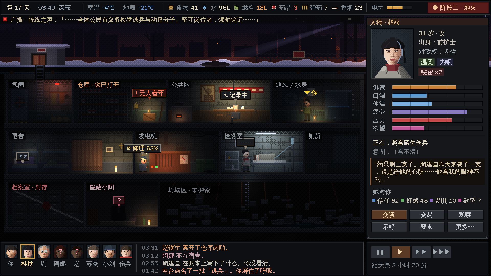
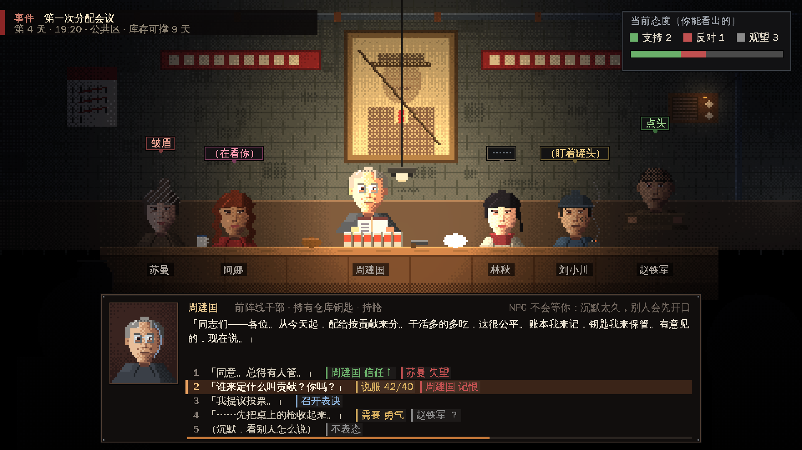
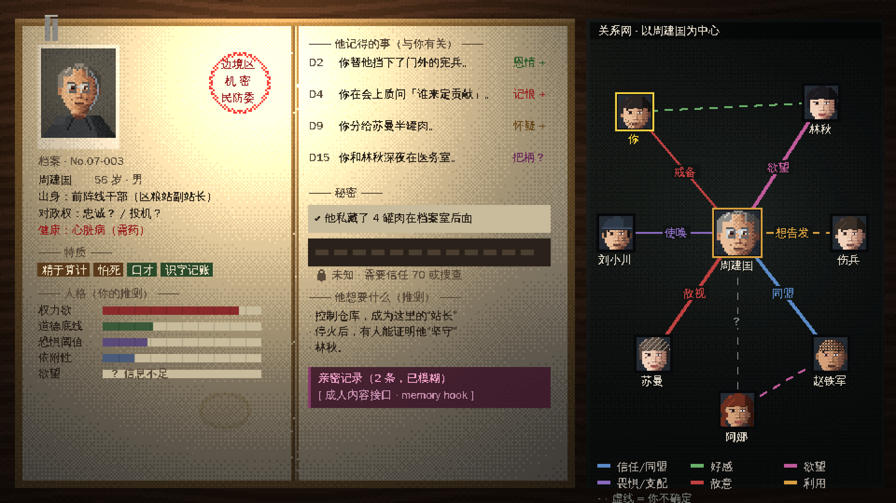
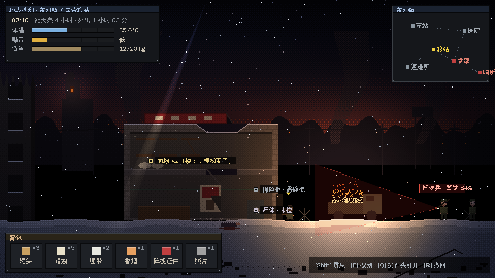

# 避难所 / New Shelter

本格生存 × 涌现式社会模拟 × 成人向叙事 · 精致像素风

- 策划案：[docs/GDD.md](docs/GDD.md)
- 目标节点网络与开放式结局（叙事骨架）：[docs/GOAL_NETWORK.md](docs/GOAL_NETWORK.md)
- 成人内容接口规范（供内容作者 / Grok 填写）：[docs/ADULT_CONTENT_INTERFACE.md](docs/ADULT_CONTENT_INTERFACE.md)
- 概念图：`concept/out/*.png`

## 概念图

| 主界面（避难所剖面） | 叙事事件（分配会议） |
|---|---|
|  |  |
| **人物档案 / 关系网** | **地表搜刮** |
|  |  |

概念图全部由代码程序化绘制（`concept/*.js`，原生 480×270，4× 放大）。重新生成：

```bash
cd concept && node render.mjs          # 需要 playwright + chromium
```

也可以直接用浏览器打开 `concept/index.html?scene=main|meeting|dossier|surface`。
